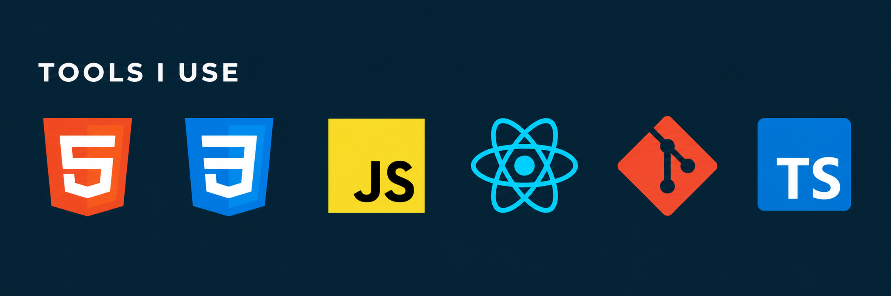

# Hi, I'm Dav 👋

I'm a front-end developer focused on building responsive, user-friendly web applications with JavaScript, React, and CSS. I enjoy learning how things work, solving problems, and improving the details that make an interface easier to use.

I hold a [Certificate of Completion for Scrimba's Frontend Developer Path](https://github.com/Davsan88/certificates/blob/main/Front-end%20development/David%20Sanchez%20-%20Frontend%20Developer%20Path%20Certificate%20of%20Completion%20-%20Scrimba.pdf) and am looking for opportunities to grow as a junior front-end developer.

## Technologies

- **Front end:** HTML, CSS, JavaScript, React, React Router
- **Tools and concepts:** Git, REST APIs, responsive design, accessibility
- **Also learning:** TypeScript

## More about me

- [Portfolio](https://davsan88.netlify.app/)
- [Certificates and courses](https://github.com/Davsan88/certificates)
- [LinkedIn](https://www.linkedin.com/in/david-sanchez-1995ab268/)

